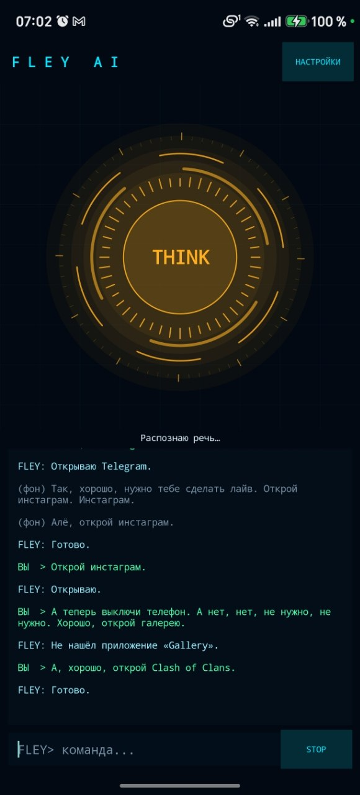
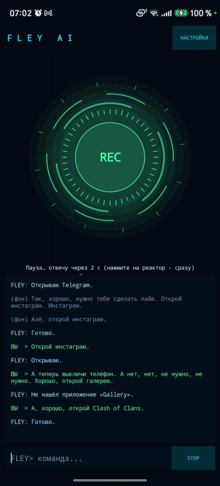

# FLEY AI для Android (APK)

FLEY AI-Voce — голосовой AI-ассистент, который не только будет с вами разговаривать, но и сможет управлять вашим Телефоном

FLEY AI-Voce is an open-source AI voice assistant project designed to control your computer (PC) rather than a smartphone.

Всё для того, чтобы автоматизировать и сделать ваш девайс и устройство, например комп и телефон, умным, как робот.

Everything to automate and make your device, like a PC and phone, smart as a robot.

TG download https://t.me/fleyai .apk and .exe PC Windows/Phone Android

Отдельная версия для телефонов: свой код (Kotlin), без лишних библиотек, оптимизирована (R8). Размер APK около 1–2 МБ.
Версия для ПК (C++) остаётся отдельно.

## Как получить APK (на Windows, один клик)
1. Запустите **build_apk.bat**. В первый раз он сам скачает JDK 17, Android SDK и Gradle (около 1 ГБ, нужен интернет), потом собирает быстро.
2. Готовый файл: **dist\FLEY_AI.apk**.

## Как поставить на телефон
- Отправьте `FLEY_AI.apk` на телефон (Telegram, облако, кабель) и откройте. Разрешите «Установку из неизвестных источников».
- Или по USB: включите «Отладку по USB», запустите **install_usb.bat**.
- При первом нажатии на реактор разрешите доступ к микрофону.

## Как пользоваться
- Нажмите на реактор: FLEY слушает постоянно, пока приложение открыто (экран не гаснет).
- Скажите «Флей, открой ютуб», «Флей, поставь будильник на 7 утра», «Флей, включи фонарик». После ответа ~25 с можно говорить без имени.
- Режимы в НАСТРОЙКАХ: смарт (по имени и по командам, фон игнорируется), только по имени, отвечать на всё.
- Строка внизу: команды можно печатать. MIC/STOP — включить/выключить микрофон.
- Телефон умеет: открыть приложение, YouTube, поиск, карты, набрать номер и подготовить SMS (отправляете сами), будильник, таймер, громкость, фонарик, время и заряд, настройки Wi‑Fi/Bluetooth. FLEY запоминает факты о вас («запомни, что…»).
- Все настройки (ключ, режим, имя, голос, пауза) внутри приложения. Ключ по умолчанию берётся из `defaults.env` при сборке.

## Ограничения
- Слушает только пока приложение на экране (Android не даёт микрофон в фоне без отдельной службы; её можно добавить следующим этапом).
- Голос — встроенный синтез речи Android. Если нет русского голоса: Настройки телефона → Язык → Синтез речи.
- iPhone не поддерживается (нужна отдельная версия).
